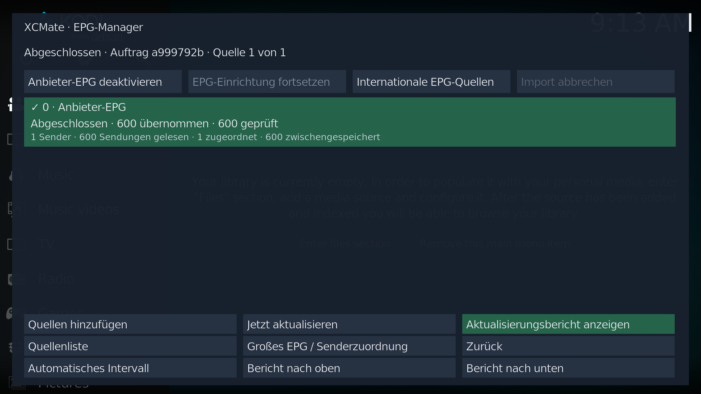

# XCMate 0.1.29.95 – Prüfstand

Draft-PR #465, Master #464. Installierbarer Testkandidat, keine Android-Abnahme, kein Merge und keine Repository-Veröffentlichung.

## Paket

- Datei: `../test-builds/02995/plugin.video.xtreammate-0.1.29.95.zip`
- SHA256: `1eed4d84c1317190f1936883eee2d9393368117f5a1e84516605c8ba141beb3b`
- Größe: 4.734.921 Bytes, 886 Dateien.
- Rebuild-Bytegleichheit, ZIP-CRC, vollständige Mitgliederliste, jeder Source-Bytevergleich und Manifest .95: PASS.
- .94-Pilot-ZIP und .90-Fallback unverändert; Veröffentlichungskanäle gegen `459817b4` geschützt.

## Bereits abgeschlossene Prüfungen

| Prüfung | Ergebnis / Beleg |
|---|---|
| Ursprüngliche .94-Reproduktion: >50 ms Zugriff und >128 Verzeichniseinträge | 2 reproduzierbare FAIL vor Reparatur; beide danach PASS |
| Neue .95-Funktionstests | 36 neue gezielte Tests, alle im abschließenden 146er-Prüflauf PASS |
| Release-/Delta-/historische Paket-/Sprach-/Boot-/neue .95-Tests | 146/146 PASS, 53,859 s; einschließlich Menüicons und bestehender EPG-Manager-Regressionen |
| Sprache | 17 PO-Kataloge PASS; neue Gate-/Profiltexte DE/EN mit vorhandenem Englisch-Fallback |
| Host-Zwei-Quellen-Pipeline | Echter Import, Sicherung, Gate READY, akzeptierter Folgeauftrag und unabhängiges Readback PASS; kein realer EPGShare-Endpunkttest |
| Abbruch / Offline / manipulierte Sicherung / veränderte DB | PASS, LastGood erhalten bzw. neue Freigabe korrekt verweigert |
| Guide-/WAL-/Backup-Erhalt bei lesender Prüfung | PASS; SQLite-SHM-Lesermarken sind kein unveränderlicher Dateisnapshot |
| Automatische Wartung .95 | Aktiver Guide und Backups geschützt, PASS |
| Physische Android-Box B, DE+AT | ANDROID_NOT_TESTED |

## Vollständige abschließende Tests

- **GitHub unittest: 4.017/4.017 PASS**, 910,760 s, auf Source-/Test-Commit `1bc86a07affceaa3fe615ffe556b4f451bdd5589`. [Grüner vollständiger Hostlauf](https://github.com/artattakk-creator/kodi-noodleprivate/actions/runs/43698021484/job/132762828980).
- **Lokaler vollständiger pytest: 4.028 PASS**, 1.023,03 s (17:03), derselbe Commit. Keine FAIL, keine ERROR, keine künstlichen Skips.
- Zusätzlich im grünen Host-CI: 11/11 Branding-pytests PASS, alle 17 PO-Dateien validiert, kompiliert, ZIP reproduziert und jeder Source-Bytevergleich bestanden. Diese 11 Tests sind keine zusätzlichen unabhängigen Produktfälle zur obigen pytest-Gesamtzahl.
- Vier bestehende pytest-Warnungen: drei Python-3.14-Deprecation-Hinweise der gepinnten externen simpleeval-0.9.13-Testabhängigkeit, ein SyntaxWarning beim Parsen einer historischen Zeichenkette mit `\/`. Keine neuen Laufzeitfehler und keine unterdrückte Testwarnung.
- **Zusätzliche komplette GitHub-CI PASS:** [Gate/Profil/native-Gesamtlauf](https://github.com/artattakk-creator/kodi-noodleprivate/actions/runs/43698021646/job/132762832428): 4.017 unittest-Tests in 892,639 s, 4.028 pytest-Tests in 950,65 s, vier oben erklärte Warnungen. PO-/Paketprüfung ebenfalls PASS.
- Dieser Workflow prüft standardmäßig GitHubs provisorischen PR-Testmerge `a606ba5c28464936ecb711657d3ef0c1d7ae1935` gegen die aktuelle main-Basis. **Kein Merge nach main wurde ausgeführt.** Runtime und ZIP sind bytegleich zum separat geprüften Branch-Head `1bc86a07`; der eigenständige vollständige Hostlauf oben prüft ausdrücklich diesen Head.
- **Alle 17 zugehörigen GitHub-Workflows abschließend SUCCESS** zum geprüften Source-/Teststand. Darunter die alten 100-Zyklen-/305-s-Bildhaltungs-/900-s-Home-/Kaltstart-Gates. Ein .89-Bildjob benötigte genau einen identischen Wiederholungslauf; Details und erster FAIL unten. Vollständige Run-IDs/Links: `CI_WORKFLOWS.json`. Optionale manuelle Diagnosejobs sind vom Workflow planmäßig SKIPPED und werden nicht als Produkt-PASS gezählt.

Der installierte Runtime-Quellstand ist `d47ad2205f87418855fd0df06fac8d9f24d366d9`; `1bc86a07` ergänzt ausschließlich den typed-PROFILE_BUSY-Testvertrag. Dokumentationsänderungen verändern das ZIP nicht.

## Native EPG-Prüfung des endgültigen Pakets

[GitHub Actions: .95 Gate/Profil/native](https://github.com/artattakk-creator/kodi-noodleprivate/actions/runs/43698021646), Source-/Test-Commit `1bc86a07affceaa3fe615ffe556b4f451bdd5589`; Runtime-Commit `d47ad220`. Reale Linux-Kodi-Version **21.2**, zwei Auflösungen. Kein physischer Android-Test und keine Behauptung einer Kodi-21.3-Geräteabnahme.

| Nachweis | 1280×720 | 1920×1080 |
|---|---:|---:|
| Gesamter nativer EPG-Vertrag | PASS | PASS |
| Tatsächlich gelesene Downloadbytes | 362.544 | 362.544 |
| Commit / unabhängiges Cold-Readback | 600 / 600 | 600 / 600 |
| Dienst-ACK | 0,215 s | 0,219 s |
| Langsamer Gate-Readback | IMPORT_AUTHORIZED / 92,21 ms | IMPORT_AUTHORIZED / 95,30 ms |
| Max. native Eingabe-RPC-Laufzeit im Test | 3,15 ms | 2,67 ms |
| Spinner beendet / Fokus / Quellenzeile erhalten | PASS | PASS |
| Zweiter echter Importstart nach Sicherung | PASS | PASS |
| Abbruch / LastGood / Back schließt nur Manager | PASS | PASS |
| ZIP SHA256 im CI-Artefakt | 1eed4d84…141beb3b | identisch |

Die Legacy-Harnessnamen `epg94` in den JSON-Dateien bezeichnen den wiederverwendeten Testharness. Das tatsächlich geprüfte ZIP ist .95; beide `package-proof.json` bestätigen jede Source-Datei und die endgültige SHA256. Artefakt-ZIPs wurden zusätzlich gegen ihre GitHub-SHA256 geprüft, nicht nur deren Status abgelesen. Details: `NATIVE_720_epg94.json`, `NATIVE_1080_epg94.json` und zugehörige Paketnachweise.

## Native BINGIE-/Widget-Regression des exakten ZIPs

[GitHub Actions: .95 ZIP in nativem Kodi 720p/1080p](https://github.com/artattakk-creator/kodi-noodleprivate/actions/runs/43698021656): beide Jobs PASS. Aus den heruntergeladenen, gegen die GitHub-Artefakt-SHA256 geprüften Nachweisen:

- Installierte Version .95, SHA256 identisch zum Testpaket, 885 installierte Nicht-Manifest-Dateien bytegleich. Das Testmanifest ist für isolierte Fixture-Abhängigkeiten angepasst; der produktive Service wird im BINGIE-Test nicht als Hardware-Systemtest ausgeführt. Diese Einschränkung steht im Paketnachweis.
- Original-SkinShortcuts 2.1.0: tatsächliche Auswahl/Speicherung, clock50-Pfade erhalten, frisches Profil ohne Portal bedienbar.
- Native Container 1510: 88 Sender; 1520: 24 Filme; 1530: 24 Serien, sichtbare Pixel nachgewiesen.
- Sechs Reihen, Spinneranimation, erhaltene fremde Definitionen und drei kalte Neustarts: PASS.
- 20 Gruppen mit 2.740 Sendern, 20 echte native Senderwechsel, gezieltes Nachladen bei bestehendem vollständigen und unvollständigen Modell, kein EPG-Zwang: PASS im synthetischen Linux-Kodi-Test.
- Persönliche gespeicherte Widgetpfade und Compiler-/Properties-Prüfsummen erhalten. Keine Veränderung einer Benutzerbox.

Details: `NATIVE_BINGIE_720_picker90.json`, `NATIVE_BINGIE_1080_picker90.json` und jeweilige Paketnachweise. Die verschachtelten PASS-Beobachtungen werden nicht künstlich als zusätzliche unabhängige Testfälle aufsummiert. Physisches Android weiterhin ANDROID_NOT_TESTED.

## Zusätzliche reproduzierbare Hostproben

`python docs/XCMate/02995/HOST_SONDERPROBEN.py`: **2 PASS**. Ein echter SQLite-Fortschrittshandler unterbricht die Abfrage mit SQLite-Code 9 → DB_INTERRUPTED. Ein PROFILE_BUSY-Aufruf der EPG-Sicherungsroute beendet genau ein Kodi-Verzeichnis und erhält die synthetische Portaldatei bytegleich. Ergebnis in `HOST_SONDERPROBEN.json`. Diese zwei Proben sind zusätzlich zu den unittest-/pytest-Zählungen ausgewiesen.

## Zwischenläufe und korrigierte Prüfumgebung

- Ein erster Gesamtlauf ohne Sandbox-Netzfreigabe konnte lokale HTTP-/SMB-Testserver nicht öffnen (`PermissionError`). Diese Umgebungsfehler sind keine Reparaturen oder bestandenen Netzwerktests; der vollständige Lauf wird mit erlaubten lokalen Sockets wiederholt.
- Im anschließenden älteren Source-Lauf wurden zunächst vier Testvertragsabweichungen sichtbar: zwei eingefrorene Kanalschutztests mit Stand vor der separat veröffentlichten .94, ein neuer nicht lokalisierter Profilhinweis und eine neue private Proof-Sidecar im Boot-Dateierhaltstest. Kanalschutz bezieht sich jetzt auf die unveränderte aktuelle main-Basis; neue Hinweise stehen in den zentralen Sprachressourcen. Original-Profildateien bleiben bytegleich. Diese Punkte sind im abschließenden 146er-Prüflauf bestanden. Zusätzlich wurden der neue Sicherungsdialog auf den vorhandenen Icon-Select-Wrapper und die bestehende Manager-Abnahme auf den nun asynchronen Auftrag umgestellt (vor Workerstart kein Request; nach Drain exakt der ausdrücklich angeforderte Request).
- Der ältere direkte Snapshot-Test erwartete noch eine rohe TimeoutError. Er prüft jetzt PortalReadError mit reason=PROFILE_BUSY; geänderte oder gelöschte Dateien bleiben weiterhin strikt gesperrt.
- Ein nativer Widget-Prüfer verwendete noch den .94-Manifestprüfer für ein .95-ZIP; auf den tatsächlichen .95-Prüfer korrigiert. Kein Produktverhalten für diesen Harnessfehler geändert.

## Zusätzliche abgesicherte Randfälle

- Gate-Ablehnung vor dem ersten Importbericht: der automatische Scheduler prüft auch den dauerhaften Refresh-Status. Vorher reproduzierbar erneuter Vorschlag, nachher begrenztes Backoff ohne neue Sicherung. Manuelle Neuprüfung bleibt möglich.
- Die Importfreigabe erhält im vorhandenen GUI-Owner-Pool ein begrenztes 35-s-Jobbudget; andere Jobs bleiben bei 4 s. Gate-Abbruch prüft Fenstergeneration, Schließen und Kodi-Ende. Test: beim Schließen während der Prüfung entsteht kein verspäteter Importauftrag.
- Hostmessung auf synthetischem Guide: bei 80 ms lokaler Verzögerung .94 BACKUP_REQUIRED nach 80,864 ms, .95 READY nach 85,418 ms. 120.000 Quellzeilen: kalte Inventur 230,169 ms, gleiche unveränderte Generation 0,041 ms. Messung auf Linux am dokumentierten Zwischencommit, keine Android-Leistungszusage; siehe HOST_MESSWERTE.json.

## Offene Freigabepunkte

Alle Schritte der `ANDROID_ABNAHME_DE.md` bleiben ANDROID_NOT_TESTED. Öffentliche EPGShare-DE/AT-Erreichbarkeit, RK3528-Speicherlatenz, echte Guide-Größe und gleichzeitige Kodi-Menüs müssen auf Box B geprüft werden. P1-Artwork-/andere EPG-Lesebudgets und native MediaCodec-Probleme sind separat offen. Keine Datenlöschung oder Rückinstallation als Testmaßnahme.

## Statusmatrix #464

| Teilauftrag | Implementierung / Host- und Linux-Kodi-Nachweis | Android |
|---|---|---|
| P0 unabhängige Backupfreigabe | IMPLEMENTED, PASS inkl. langsamer Zugriffe, 150 weiterer Receipts, Busy, Interrupt, Belegfehler, Archivverschiebung/Neustart, Low-Space und Concurrent Revision | ANDROID_NOT_TESTED |
| P0 strukturierte Diagnose / begrenzter Retry | IMPLEMENTED, PASS; kein Freigabe-Bypass und kein automatisch wiederholter Backupauftrag | ANDROID_NOT_TESTED |
| P0 Profilsperren und Reminder-Leerlauf | IMPLEMENTED, PASS; unveränderte bewiesene Dateigeneration oder typed PROFILE_BUSY | ANDROID_NOT_TESTED |
| P0 quellweise aktuelle Inventur / historische Readbacks | IMPLEMENTED, PASS; 120.000 Quellzeilen und langsame Einzelquelle | ANDROID_NOT_TESTED |
| P0 Daten-/Backup-Erhalt | PASS in Wegwerfprofilen, keine Benutzerbox angefasst | ANDROID_NOT_TESTED |
| P0 echter DE+AT-Import auf RK3528 | Anleitung vorbereitet, öffentliches Endpunkt-/Geräteergebnis noch offen | ANDROID_NOT_TESTED |
| P1 andere EPG-Lesebudgets / LOCAL_EVENT-Bilder | OPEN, getrennter Folgeauftrag | ANDROID_NOT_TESTED |
| P1 Artwork-Reserve / Volumes | OPEN, nicht mit EPG-Gate-Fehler gleichgesetzt | ANDROID_NOT_TESTED |
| P2 native MediaCodec-/Skin-/fremde SMB-Fehler | OPEN, keine unbelegte Hardware-Reparatur | ANDROID_NOT_TESTED |

**Freigabestand:** Testkandidat zur Prüfung; keine automatische Merge-/Repository-Freigabe. Issue #464 bleibt offen.

## Separater älterer Bild-/Logo-Harness: nicht verschweigen

Im ersten .89-Nativlauf bei 1080p meldete Job `132762828423` nach den Logo-/Sticky-Prüfungen `POSTER89_NOT_FIVE_DISTINCT_ITEMS, vod, 3`. Der identische 720p-Lauf bestand. Das Fehlerartefakt wurde heruntergeladen und SHA256-verifiziert. Der Beobachter prüft nach `selectItem(index)` nur, ob das globale aktuell gemeldete Item ein gültiges lokales Poster hat; er wartet nicht ausdrücklich auf die angeforderte neue Item-ID. Ein verzögertes Kodi-InfoLabel kann dadurch als bereits gültiges altes Item akzeptiert werden. Dies ist ein nachvollziehbarer Timingverdacht, noch kein bewiesener Produktfehler oder Beweis seiner Abwesenheit.

Ein einzelner identischer Wiederholungslauf wurde als Diagnose ausgeführt, ohne Produkt-, Harness-, Bild- oder Timeoutänderung: Job `132769244901` **PASS**. Damit ist der Workflow abschließend grün. Der erste Fehler bleibt mit Job-ID, Fehlercode und Artefakt-SHA in `LEGACY89_ERSTER_FEHLER.json` erhalten. Das unterschiedliche Ergebnis bei identischem Quellstand bestätigt einen nicht stabil reproduzierten Testlauf; die genaue Timingursache und deren Ausschluss auf Android bleiben offen. Ein Ergebniswechsel durch Wiederholung gilt nicht als Produktreparatur. Der heruntergeladene Wiederholungsnachweis bestätigt jeweils fünf unterschiedliche lokale Film- und Serienposter im Warmzustand und nach zwei Kaltstarts; 88 Logo-Referenzen bleiben vorhanden, nach Neustart ohne erneute Downloads. Details: `LEGACY89_RETRY_PROOF.json`. Die unabhängigen .95-EPG- und exakten BINGIE-ZIP-Prüfungen in beiden Auflösungen sind bereits PASS. Android-Bildstabilität bleibt offen.

## Dokumentation nach Abschluss der Tests

Der abschließende Dokumentationscommit enthält ausschließlich `docs/XCMate/02995/`: Berichte, synthetische Messnachweise und ein natives Testbild. Er ändert keine Add-on-Datei, keinen Test, kein Tool, keinen Workflow und kein ZIP. Diese Identität wird gegen den vollständig geprüften Commit `1bc86a07` sowie die SHA256 des heruntergeladenen CI-Pakets geprüft. Für diese reine Dokumentation werden die abgeschlossenen bis zu 50-minütigen Workflows nicht erneut ausgelöst; der CI-Nachweis bezieht sich ausdrücklich auf den oben genannten unveränderten Quell-/Teststand. Dies ersetzt keine Prüfung einer späteren Codeänderung.
