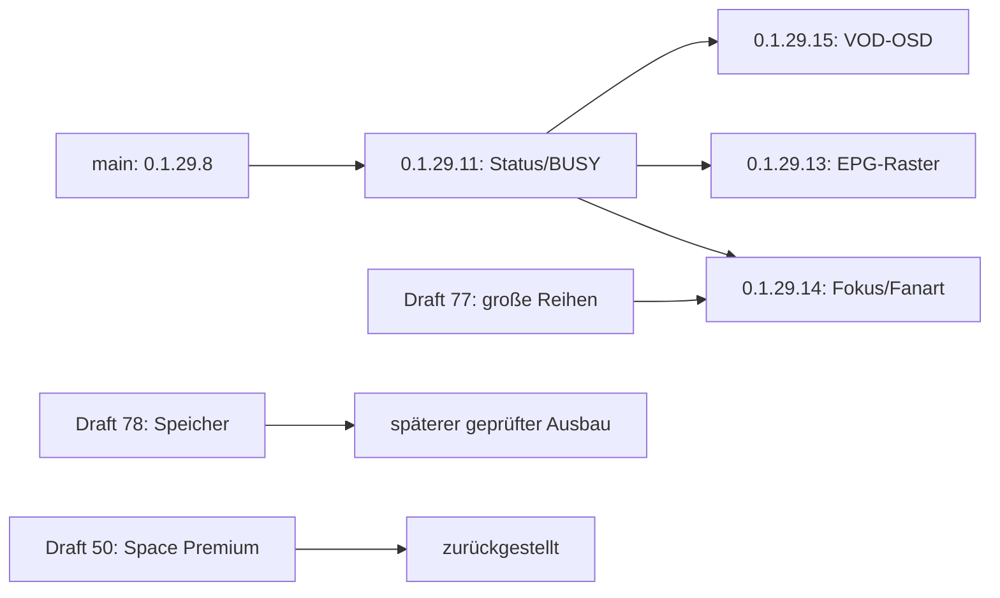

# Integrationsstand 22.10.2026 – 0.1.29.11/13/14/15

Produktiv/Android-abgenommen: **0.1.29.8**, #73 geschlossen. Die berichteten
20/20 Reopen-, 6/6 Doppel-Back- sowie Detail-/Playback-Prüfungen werden erhalten.
Alle neuen Kandidaten haben **Android NOT_RUN** und bleiben Drafts/Test-ZIPs.
Keine eigenmächtigen main-Merges, Releases oder regulären Updates.

**13/14/15 sind getrennte Geschwister-Kandidaten auf Basis 11**, kein kumuliertes
Produktivrelease. Ein höher nummeriertes ZIP enthält deshalb nicht automatisch
alle anderen Feature-Drafts. Zuerst 11 auf der Box prüfen, danach die jeweiligen
Funktionen getrennt. Erst nach positiver Geräteabnahme in einem eigenen neuen
Integrationsstand zusammenführen; Versionsnummer vorher erneut reservieren.
Keine 0.1.30 oder höher erzeugen. Bestehende Pakete bleiben unverändert.

| Draft | Technisch geprüft | Weiteres Vorgehen |
|---|---|---|
| #77 / 0.1.29.9 | Native Scrollgruppe und stabile IDs/Fokuswege; gezielte UI-Commits in 14 übernommen | Neue Anforderungen Neongrün und echte Fanart in 14 testen, altes ZIP unverändert lassen |
| #78 / 0.1.29.10 | Speicherprofile/Queue/lokale USB-Migration vorhanden, direkter SMB/VFS-Ausbau offen | Nicht ungeprüft übernehmen; Status/BUSY-Reparatur aus 11 vor Integration portieren, aktuelle Settings/Cachepfade unverändert |
| #50 / 0.1.30.1 | Unveränderter historischer Theme-Draft 0840f7c, 98 Originalgrafiken | Ausdrücklich zurückgestellt, nicht integrieren oder veröffentlichen |

Read-only `git merge-tree` zwischen 11 und #78 zeigt Konflikte in Manifest,
Changelog, beiden Sprachkatalogen, app_routes, art_store, window_navigation und
Versionstests. Darüber hinaus ist ein semantischer Konflikt wichtig: Der neue
read-only Schema-Schnellpfad darf bei späterem #78-Merge dessen zusätzliche
art_state/art_inventory-Tabellen nicht überspringen. Der #78-Statusdialog darf
nicht wieder zur gemeinsamen fehleranfälligen Writer-/Statistikabfrage werden.
Read-only Snapshot und unabhängige Kapazitätsinformationen müssen erhalten
bleiben; Kapazitätspausen dürfen keine Netzwerkversuche verbrauchen.

Die Speicherprofile bleiben eine bewusste spätere Benutzerwahl. Kein neuer
Default, keine Änderung an settings.xml oder am laufenden Profil. Direkter
SMB-/content://-Schreibbetrieb bleibt ein eigener Schritt mit echtem Kodi-VFS-
Adapter, verifiziertem Freiraum/Reserve, sicherem Datei-Commit, Offline-Snapshot,
Hashprüfung und Android-Berechtigungsabnahme; keine Python-Dateioperationen auf
smb:// und keine behauptete Vollunterstützung. Vorhandene Bilder immer behalten.

## Aktuelle Testpakete und Freigabegrenzen

| Version | Draft-PR | Hosttests | Android |
|---|---|---:|---|
| 0.1.29.11 Status/BUSY | [#80](https://github.com/artattakk-creator/kodi-noodleprivate/pull/80) | 568 | NOT_RUN |
| 0.1.29.15 VOD-OSD | [#84](https://github.com/artattakk-creator/kodi-noodleprivate/pull/84) | 581 | NOT_RUN |
| 0.1.29.13 EPG-Raster | [#82](https://github.com/artattakk-creator/kodi-noodleprivate/pull/82) | 584 | NOT_RUN |
| 0.1.29.14 Medien-UI | [#83](https://github.com/artattakk-creator/kodi-noodleprivate/pull/83) | 580 | NOT_RUN |

Der eigene erste Player-Draft #81 / 0.1.29.12 ist **zurückgezogen, nicht
installieren**. Beim abschließenden Kodi-21.2-API-Abgleich wurde das ungültige
RPC-Feld canpause erkannt, das das frühe Hostmodell nicht geprüft hatte.
Das alte ZIP bleibt unverändert, deshalb neue freie Version 0.1.29.15; diese
verwendet die belegten Player.PauseEnabled/Player.SeekEnabled-Bedingungen.
Die übrigen Player-Methoden und Subtitle-Visibility sind gegen Kodi 21.2 geprüft.

Für 11 ist GitHub-CI ebenfalls PASS. Die Feature-PRs sind für isolierte Reviews
gegen den 11-Branch gestapelt; der nur auf main-PRs konfigurierte Workflow
startet dort noch nicht. Die vollständigen Hostlogs/Hashes liegen in allen
Branches. ZIP-CRC, sichere Pfade, Source-Bytes und byteidentische unabhängige
Reproduktion sind jeweils PASS. Alle Python-Dateien bestehen zusätzlich die
3.11-Grammatikprüfung; eine ausgeführte Kodi-/Android-Laufzeit wird nicht behauptet.

## Noch offene Geräte-/Featuregrenzen

- #75/#69: exakte historische Android-Exception bleibt mangels Stacktrace offen;
  konkrete Writer-Konkurrenz ist reproduziert, Statusfix muss zehnmal real öffnen.
- #79: historische Live-Tape-Deck-Optik belegt, separates altes VOD-OSD nicht sicher
  identifiziert. Neue VOD-Rekonstruktion enthält keine aktive Downloadfunktion.
- #57: erster proportionaler Guide mit lokalen 8er-Seiten, explizitem Watch,
  Details/Reminder/Merken. 7–10 Tage nur soweit reale Daten vorhanden. TMDB,
  Catch-up, Recorder und erweiterte Senderzuordnung sind keine fertigen Funktionen
  dieses ersten Rasters. Historische 288/2764 XMLTV-Mappings sind keine neue Messung.
- #74: echte TV-Lesbarkeit, passende farbige Fanart und Fokus auf allen Ebenen
  nur auf dem Gerät endgültig bewertbar. SVG-Dateien sind gekennzeichnete Modelle,
  keine vorgetäuschten Kodi-/Android-Screenshots.

Private Logs/Portaldateien/SQLite-Daten und Tokens werden nicht hochgeladen.
Die vorhandenen privaten Workspace-Änderungen und 98 Theme-Originale bleiben
unverändert. Neues Bookmarking im EPG speichert nur nach bewusster Bestätigung
in einer eigenen Datei; bestehende EPG-/Mapping-/Favoriten-DBs werden nicht migriert.
