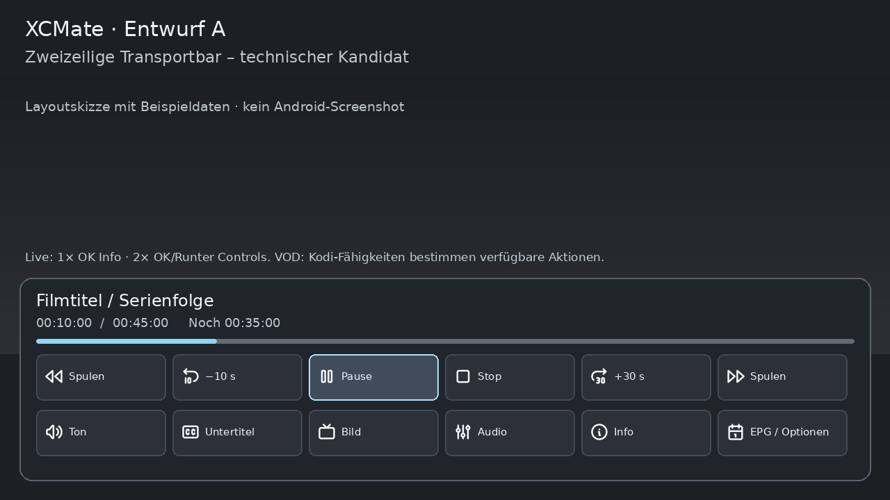
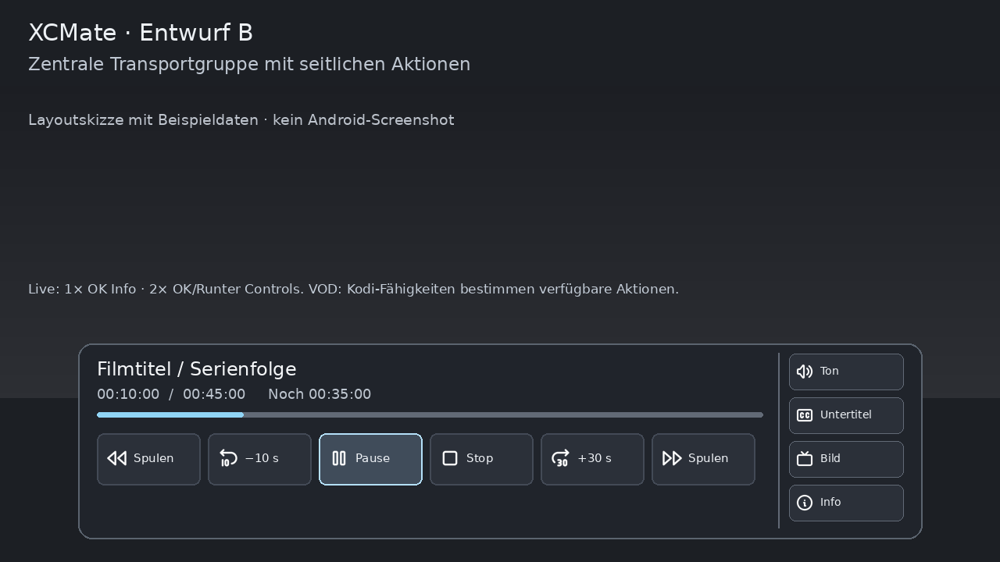
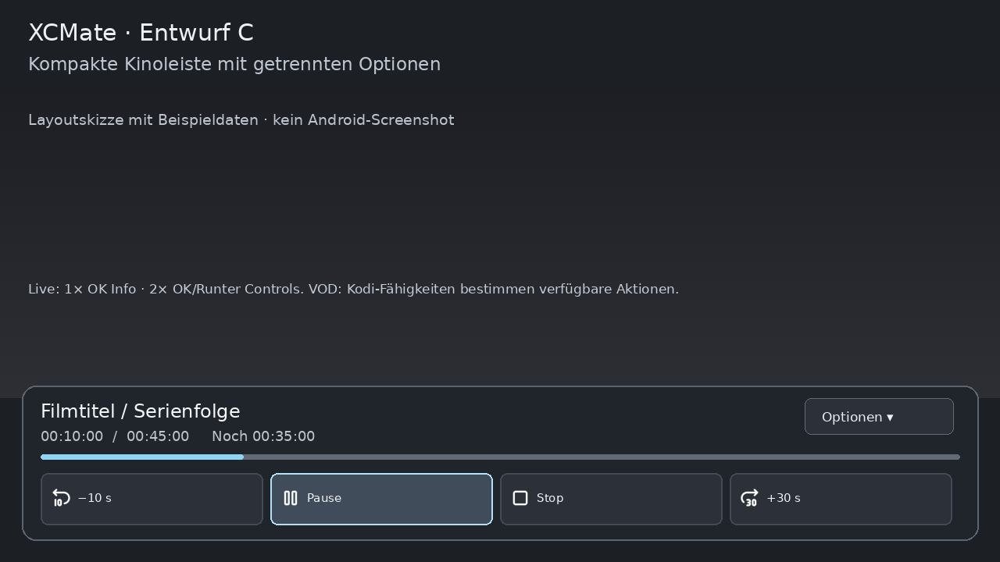

# .38 – drei OSD-Entwürfe zur späteren visuellen Auswahl

**Keine Android-Screenshots, keine Designabnahme.** Die Skizzen zeigen Anordnungen mit ausdrücklich fiktiven Beispieldaten. Der technische Testkandidat verwendet **A als vorläufige Arbeitsvariante**, damit Buttons, Fähigkeiten, Ownership und Fernbedienung bereits geprüft werden können. Ein finaler visueller Stil oder Merge wird daraus nicht abgeleitet.

## A – zweizeilige Transportbar

Transport und Einstellungen bleiben getrennt und aus TV-Abstand erreichbar. Live zeigt beim ersten OK weiterhin nur die kompakte Infoleiste; der zweite OK/Runter öffnet die Controls. VOD hat Timeline/Restzeit, echte Pause/Stop, unterstützte Sprünge/Spulen sowie Ton/Untertitel/Bild/Info. Die tatsächlich verfügbaren Buttons richten sich nach Kodi und Stream, nicht nach diesen Beispieldaten.

## B – zentrale Transportgruppe

Weniger Gewicht links; Ton-/Untertitel-/Bildaktionen an einer zusätzlichen Kante. **Nur Layoutskizze**, im Kandidaten kein zweiter Laufzeitstil. Vor Umsetzung der zusätzlichen Fokusrichtung wäre eine eigene IR-Abnahme erforderlich.

## C – kompakte Kinoleiste

Wenige große Hauptaktionen, weitere Optionen in einer eigenen zweiten Ebene. **Nur Layoutskizze**, nicht als implementierte alternative Oberfläche behauptet. Vorteil: weniger Bildabdeckung; Nachteil: mehr Tastenschritte.

Alle Skizzen: lokale MIT-Tabler-Icons aus derselben gepinnten Quelle wie die Rail, Original-App-Icon und Suchmaske bleiben unverändert. Quelle/Hashes: `resources/media/navigation/manifest.json`; Generator: `tools/render_xcmate_osd_layouts_02938.py`. Die Skizzen sind nicht der Nachweis von echter Pause-/Seek-/Timeshift-Fähigkeit. Die .38-Abnahme muss reale Kodi21.2/21.3-Controls und beide Skins separat prüfen.
