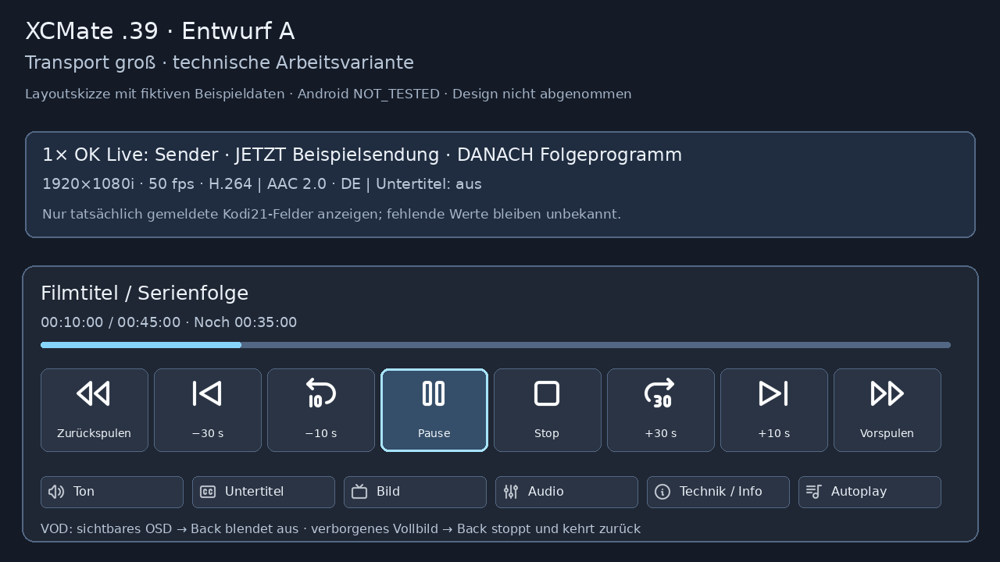
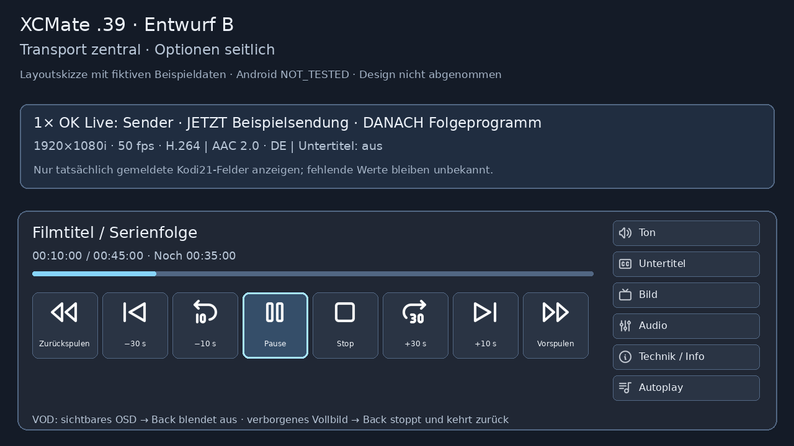

# .39 – zwei Player-Entwürfe zur Auswahl

Diese Bilder sind **Layoutskizzen mit fiktiven Beispieldaten**, keine Android-Screenshots und keine Designabnahme. Der Testkandidat verwendet A als technische Arbeitsvariante. Tatsächliche Pause-/Seek-Fähigkeiten und Kodi-Daten bestimmen die angebotenen Funktionen; eine fehlende Auflösung/Scanart/HDR-Angabe wird nicht aus dem Sendernamen ergänzt.

## A – große Transportreihe, untergeordnete Optionen

Große zentrale Symbole für Pause/Play, Stop, Spulen und unterstützte Zeitsprünge. Native Fokusflächen, Timeline und echte Restzeit. Ton, Untertitel, Bild, Audio, technische Details und Serien-Autoplay in einer kleineren zweiten Zeile. Die kompakte Live-Infobar bleibt die erste OK-Ebene; zweites OK/Runter öffnet die Controls. Der vorhandene EPG-Button bleibt verfügbar.

## B – zentrale Transportgruppe, seitliche Optionen

Alternative Anordnung für die spätere visuelle Entscheidung. Technisch noch kein umschaltbares Layout: dieselben echten Funktionen, Optionen an der rechten Kante. Die endgültige Breite, Schriftgröße und Fokusdarstellung müssen auf BINGIE mit der IR-Fernbedienung geprüft werden.

Bei VOD schließt Back zuerst das sichtbare OSD. Back aus bereits verborgenem Vollbild und explizites Stop beenden ausschließlich die eigene Session und stellen den ursprünglichen Medien-/Suchkontext wieder her. Natürliches Serienende und Resume bleiben davon getrennt. Kein Kodi-Keymap- oder Skinpatch.

Reproduktion: `python tools/render_xcmate_osd_layouts_02939.py`. Gepinnte lokale MIT-Tabler-Icons aus dem Add-on; Original-XCMate-Icon unverändert. Bildprüfsummen in `osd_02939/manifest.json`.
