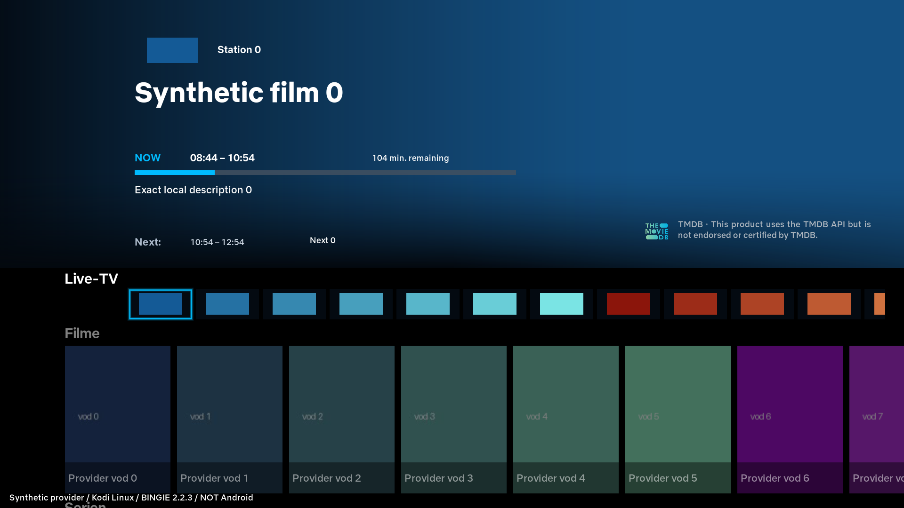
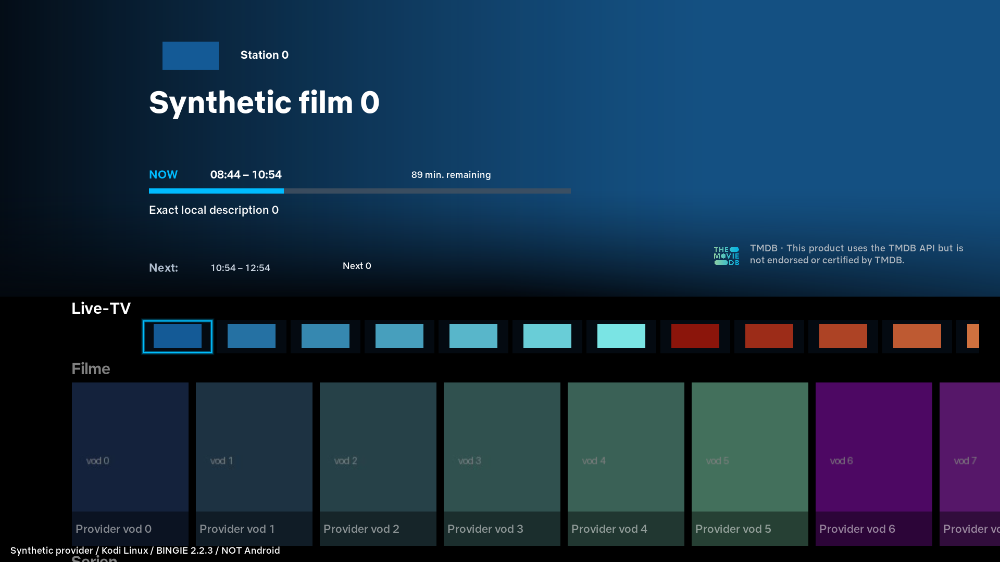
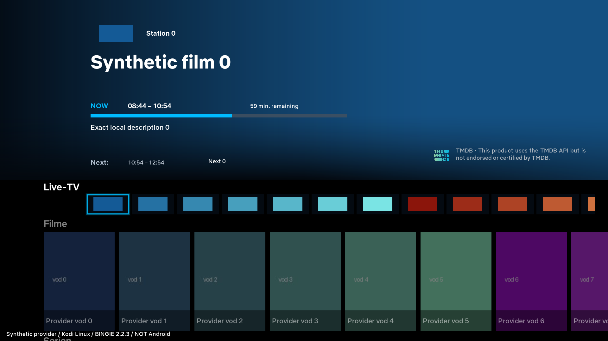
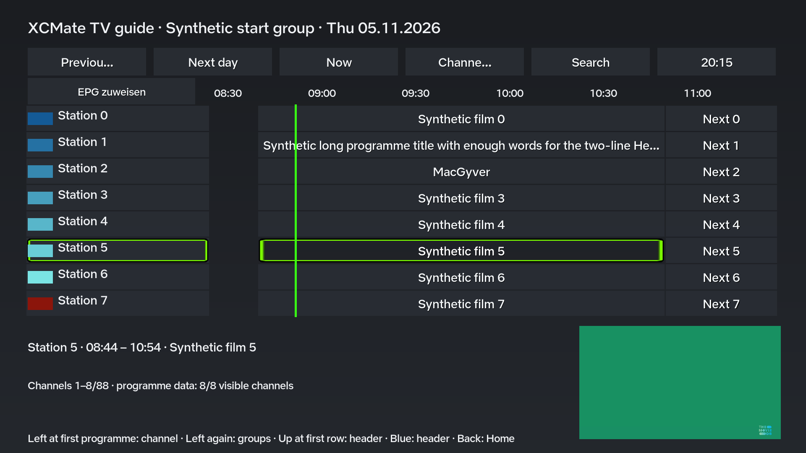
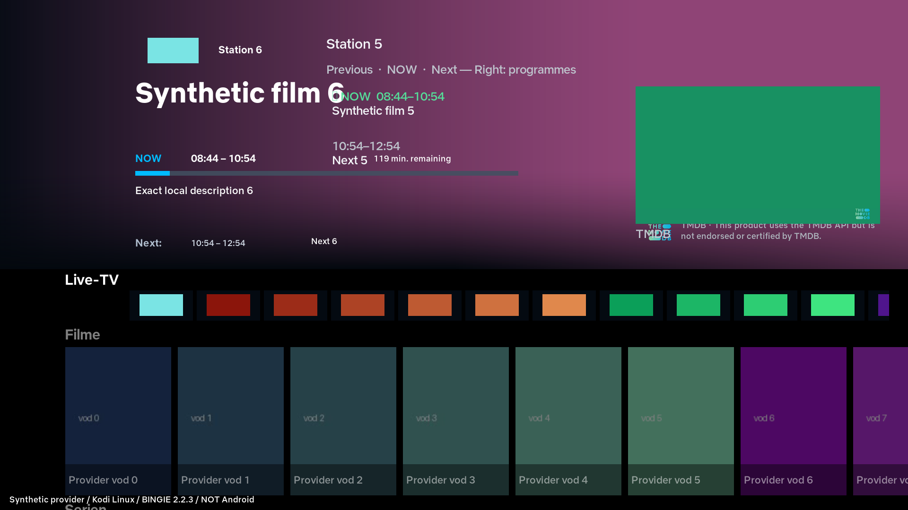
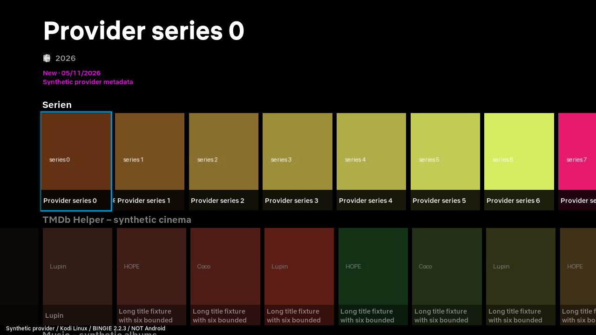

# XCMate 0.1.29.74 – abschließender Testbericht

**Testkandidat für Geräteabnahme. Kein Merge, kein produktives Release.**

ZIP-Quellstand: `fa7782d4d8a3fdc13d62acc7a228bc655b2bb73a`, kumulativ auf main `2e9e81c696c65b6dfdf0293efca9ed5b51c7bab8` (.73 plus bereits freigegebener Installer 0.5.21). Spätere Dokumentations-/Nachweiscommits ändern die ZIP-Quellen nicht.

SHA256: `8d3f08b1761e5f2ad6ffb061b24e6261c3b68ee35d197eab827e9fbac02f8e67`.

## Ausgeführte Prüfungen

| Prüfung | Tatsächliches Ergebnis |
|---|---|
| Vollständige GitHub-Hostsuite | **3.054/3.054 PASS**, 705,883 s, keine Fehler/Failures; vorhandene Testmethoden und Skip-Verträge erhalten |
| Lokale vollständige Suite vor den drei ergänzten Fehler-/Diagnosefällen | 3.051/3.051 PASS, 540,630 s |
| Neue fokussierte .74-Tests | 42 PASS, einschließlich Journal-Korruption, Quellenwechsel, Referenzstatus, Last-known-good, gültig leer, Parallelreader, opt-in Skin/Restore und EPG-Rollover |
| Bestehende separate Legacy-Testreihenfolge | 197 PASS; 1.000-Sender-Scrolltest lokal 4,485 s, 5-s-Grenze unverändert |
| Kodi-PO-Dateien | alle 17 vorhandenen Varianten validiert; neue Diagnosetexte DE/EN, bestehender Englisch-Fallback |
| Reproduzierbares ZIP | 720 Quelldateien, 3.407.986 Bytes; CRC, Dateimenge und Quellbytes verifiziert; CI erzeugt dieselben ZIP-Bytes |
| Native Auflösungen | 1920×1080 und 1280×720 **PASS**, echte Kodi-/BINGIE-Controls; Original-720p-Bild gespeichert |
| Native Bildpipeline | Vorschau, echter MiniProgramme-Control, echtes GuideGridWindow, ProgrammeWindow46 und BINGIE Home **PASS**; PNG/JPEG über echten verifizierten synthetischen HTTPS-Transport, SNI, GET/HEAD; keine Credentials am Bildhost |
| Native Rahmen/Navigation | eigene und fremde Poster-/Musik-/TV-Reihen, 10 Serienpositionen, erste/mittlere/letzte Auswahl, echte Hoch-/Runter-Aktionen: **PASS**, jeweils ein passender Rahmen |
| Echter Home-Dauerlauf | **3.600,628 reale Sekunden PASS**, 179 Hintergrundzyklen, 29 injizierte Lesebudgetzyklen, keine Workerfehler; 88/24/24 Items bei 0/15/30/60 Minuten |
| Echter Sendungswechsel | Prüfsender 86 vor Ende „Synthetic film 86“, danach „Next 86“; kein eingefrorenes JETZT |
| Nach Dauerlauf | echter Kodi-Prozessneustart (PID gewechselt), vier Hoch-/Runter-Wechsel, manueller Live-Reload und Skin-Reload: **7 native Pixel-/Bestandsprüfungen PASS** |
| Repository-Kanäle | reguläre/Pilot-Indizes und veröffentlichte Pakete unverändert; Veröffentlichungsschritt des Prüfworkflows **SKIPPED** |
| Android / RK3528 ARM32 / Kodi 21.3 | **ANDROID_NOT_TESTED** |
| Privater TMDB-/TVmaze-Echtzugang | **NOT_TESTED**; synthetische API-Antworten sind kein Nachweis des privaten Provider-/TMDB-Zugangs |

## GitHub Actions

- [Vollständige .74-Suite, Paketvergleich und native 1080p/720p-Prüfungen – grün](https://github.com/artattakk-creator/kodi-noodleprivate/actions/runs/42002535477)
- [Breiter kumulativer Testworkflow mit Live-Wiedergabe, älteren nativen Home-Verträgen, vollständiger Suite und Testartefakt – grün](https://github.com/artattakk-creator/kodi-noodleprivate/actions/runs/42003070873)

Der zweite Workflow trägt den historischen Namen „Publish GS Media Kodi updates“, wurde hier ausdrücklich auf dem Entwicklungsbranch im **workflow_dispatch-Prüfmodus** ausgeführt. „Commit and publish generated archives“ war SKIPPED. Kein main-Push und keine produktive Veröffentlichung.

## Dauerlauf und Bilder

| Zeitpunkt | Live / Filme / Serien | JETZT am ausgewählten Sender | Prüfsender 86 |
|---|---|---|---|
| 0 s | 88 / 24 / 24 | Synthetic film 0 | Synthetic film 86 |
| 900,097 s | 88 / 24 / 24 | Synthetic film 0 | Synthetic film 86 |
| 1.800,084 s | 88 / 24 / 24 | Synthetic film 0 | Next 86 |
| 3.600,056 s | 88 / 24 / 24 | Synthetic film 0 | Next 86 |

Vollständige strukturierte Nachweise: [summary74.json](test-builds/02974/evidence/summary74.json), [idle74.json](test-builds/02974/evidence/idle74.json), [post74.json](test-builds/02974/evidence/post74.json), [native Home](test-builds/02974/evidence/home.json), [URL-Pipeline](test-builds/02974/evidence/pipeline69.json).

## Genaue Grenzen und Fehlerhistorie

- Der Dauerlauf verwendet den .74-Kern `68d7b71` im **internen Artwork-Modus** mit vorhandenen synthetischen Cover-/Logodateien. Reale dynamische Provider-Leases werden zusätzlich durch fokussierte TTL-/Fehler-/Quellen-Tests geprüft; native URL-only-PNG/JPEG-Prüfungen beweisen den tatsächlichen HTTPS-Bildtransport. Das ersetzt keine einstündige Android-Prüfung des dynamischen Modus auf Box B.
- Spätere Ergänzungen fangen ausschließlich beschädigte optionale Referenzmetadaten ab und präzisieren anonyme Bildreferenz-Diagnosen. Cache-/Renderingverfahren und Veröffentlichungssignaturen bleiben unverändert. Das **finale ZIP** wurde anschließend in beiden CI-Läufen vollständig geprüft.
- Die Hintergrundschleife führt die relevanten Produktionsfunktionen für Snapshot, Artwork, Publikation und lokale EPG-Aktualisierung aus. Der vollständige Add-on-Service und externe Helper sind im wegwerfbaren Renderingprofil deaktiviert. HTTP-Timeouts werden gezielt in den synthetischen API-Transport eingespeist; dies ist kein erreichbarer privater TMDB-Echtzugang.
- Der ursprüngliche Evidenzvalidator erwartete einen gefüllten Fortschrittsbalken an einer festen 1/3-Position. Die zweistündige Testsendung war anfangs erst zu 8 % gelaufen. Der korrigierte Validator prüft die tatsächliche Prozentposition; die bereits vollständig aufgezeichneten Originalbilder wurden damit separat verifiziert. Die reale Stunde wurde weder simuliert noch zeitlich verkürzt.
- Ein früher breiter CI-Lauf verletzte den unveränderten 5-s-Grenzwert beim 1.000-Sender-Scrollen (6,182 s). Die finale Wiederholung derselben Testreihenfolge und der komplette finale Workflow bestanden. Kein Anheben des Limits und keine Änderung der Live-Navigation.
- Frühere Entwicklungsfehler in alten Menü-/TTL-Testannahmen, synthetischem HEAD-Server, Proxy-/Loopback-Zuordnung, native-init-Harness und 720p-Pixelklassifikation wurden korrigiert und nicht als PASS gezählt.
- Nur synthetische Daten und eigene Test-CA/Loopback-Origin, keine privaten Kodi-Rohlogs im Repository. Die Testprofil-Reserve beträgt bewusst 128 MiB; die Produktionsvoreinstellung bleibt 1 GiB. Keine Schlüssel-/Profil-/Datenbank-/Cache-Resets und keine Skinmodifikation während eines Updates.

## Issue-Abnahmematrix

| Teil | Umsetzung / Hoststand | Noch offen |
|---|---|---|
| #361 Home-Daten/EPG/Referenz-Leases | implementiert, 42 neue fokussierte Tests, gesamter Host-/CI-Stand grün | Android 15/30/60 Minuten, besonders dynamischer Modus |
| #361 Standardwidget-Auswahl | drei unveränderte native Quellen direkt erreichbar, keine Pflicht-Slotverwaltung; Legacy-URLs erhalten | echtes Speichern/Neustart im individuellen Android-BINGIE-Profil |
| #361 Fokus | optionaler SHA-geprüfter Adapter, native vertikale Regeln, lokale Rahmen; 1080p/720p/Reload/Neustart PASS | tatsächlicher privater Skin-SHA und Geräte-Pixelabnahme; unbekannte Anpassungen werden blockiert |
| #361 Eventbilder/Diagnose | gemeinsame bestehende Pipeline, Opt-ins, Helperbackoff, größere Guidevorschau, expliziter aktiver Abruf | privater Zugang und echte Programme auf Android |
| #357 / #358 / #359 | .73-Funktionen kumulativ erhalten, keine themenfremde Erweiterung | frühere Quellen-/Übersetzungs-/Gerätetests bleiben offen |

**Bereit als Android-Testkandidat, noch keine Merge-/Releasefreigabe.** Kein Issue wird vor der tatsächlichen Abnahme geschlossen.
