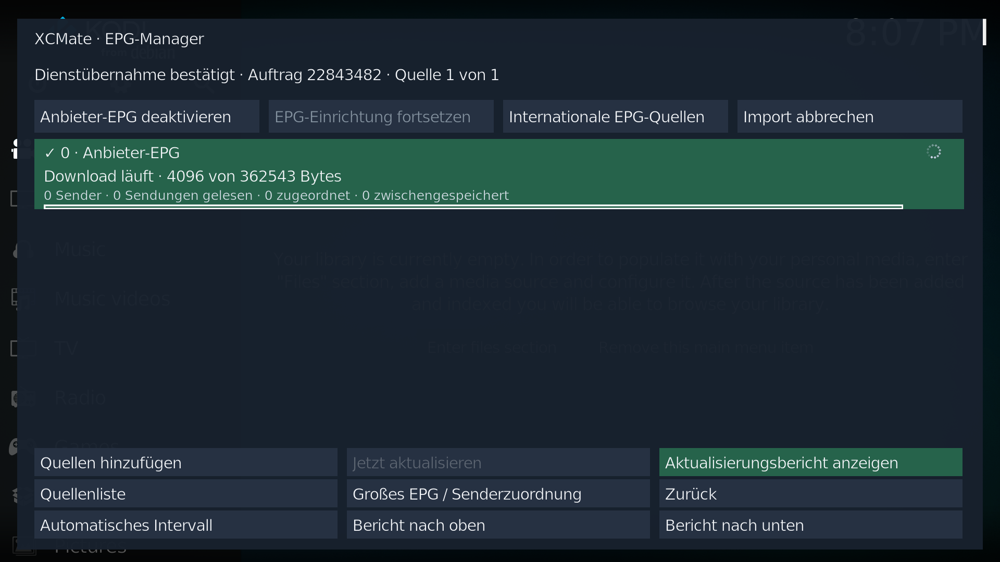
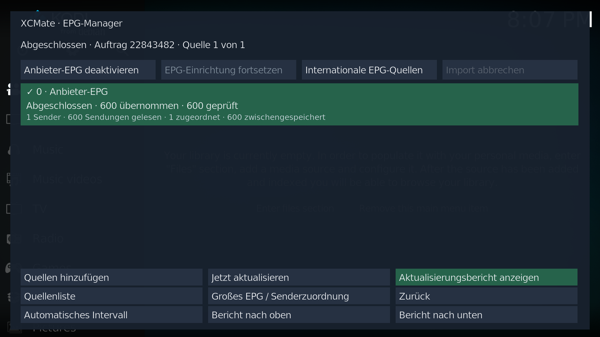

# XCMate 0.1.29.94 – Release-Candidate, Test- und Ursachenbericht

Stand 14.11.2026. Master [#458](https://github.com/artattakk-creator/kodi-noodleprivate/issues/458), Draft [#460](https://github.com/artattakk-creator/kodi-noodleprivate/pull/460). **Keine Veröffentlichung, kein Merge, keine Installation auf einer Nutzerbox. Android vollständig ANDROID_NOT_TESTED.**

## Paket und überprüfte Entwicklungsbasis

| Gegenstand | Nachweis |
|---|---|
| Branch | `fix/xcmate-02994-epg-observable-mini-groups` |
| Kumulative .93-Sourcebasis | PR #455, `f2e87846fe63b75b16916f1b9121aaee49553a8e`; lokaler Integrationsstand `a571998b` |
| .93-Quell-/Pilotvergleich | Alle 876 ZIP-Mitglieder bytegleich; SHA256 `48e0822827c2a8e8a854a812cbac0d0fb3407f6f6b9a5c3c2c2213f20fe77a95` |
| Aktuelle main-Basis | `b830fad1a19247cc08750970dc56edae0b8c2361`, einschließlich unabhängiger historischer Archivierung #461; nach main wurde nichts gemergt |
| Letzter Laufzeit-Codecommit | `9527b54f`; nachfolgende Änderungen betreffen Tests, CI und Dokumentation |
| ZIP | [plugin.video.xtreammate-0.1.29.94.zip](test-builds/02994/plugin.video.xtreammate-0.1.29.94.zip) |
| SHA256 | `e34e0cebd37591100c4606124aab3ef6b7310fb3fb0015be56a312af4e0d874d` |
| Paketprüfung | 4.724.767 Bytes, 882 eindeutige Mitglieder, CRC PASS, jedes Mitglied bytegleich zum aktuellen Source; keine privaten DBs/Rohlogs/pyc |
| Regulär/Pilot/NeoDark3 | Unverändert; lediglich ein ausdrücklich nicht veröffentlichtes Pilot-Overlay im Testbuild-Verzeichnis |
| Installer | 0.5.26 unverändert |

Die vollständigen technischen Ursachen und Dateien stehen in [IMPLEMENTIERUNG_02994_DE.md](IMPLEMENTIERUNG_02994_DE.md). [Issue-/Abnahmematrix](ISSUE_MATRIX_02994_DE.md), [Android-Schritte](ANDROID_ABNAHME_02994_DE.md) und der unverändert übernommene [priorisierte Backlog](BACKLOG_PRIORISIERT_AB_02994_2026-11-14_DE.md) ergänzen diesen Bericht.

## Reproduktion, Vorher/Nachher

Unveränderte .93: **3 FAIL / 1 PASS** bei Provider-Default, späterer EPG-Aktivierung, Gruppen-Nachladegate und bewusstem Opt-out. Das ursprüngliche Fehlprotokoll bleibt als [baseline-reproduction.txt](reports/02994/baseline-reproduction.txt) erhalten. Die neuen Tests bestehen nach der Reparatur; keine Android-Ursache aus dieser synthetischen Reproduktion ableiten.

| Prüfung | Vorher | .94-Nachweis |
|---|---|---|
| Xtream ohne externe Quelle | Provider-EPG und globale Freigabe wurden abgeschaltet | Tatsächliche Adapter-Adresse als Standard; ausdrückliche Abschaltungen und unbekannte Legacy-Absicht bleiben geschützt |
| DACH nachrüsten | Quellen gespeichert, globale Importsperre blieb bestehen | Idempotente Quellen, dauerhafter Schalter-Readback, erforderliche Nutzerbestätigung |
| Aktualisieren | Angefordert konnte als scheinbarer Erfolg erscheinen | Dauerhafte Job-ID, echte Worker-ACK, 15-s-Annahmefrist, eindeutiger Fehler ohne ACK |
| Fortschritt | Periodischer kompletter Listenaufbau, kein eingebetteter Quellenfortschritt | Reale HTTP-Wirebytes und Parser-/Mapping-/DB-Zähler, pro Quelle Spinner/Balken, stabile ListItems/Fokus |
| Erfolg | Fehlender vollständiger unabhängiger Quell-Readback | Quell-/Revisions-/Count-/Inhaltshash vor Commit und neue read-only Verbindung nach Commit |
| Mini-EPG | Fehlende Gruppen nur bei Partial-Flag nachgeladen | Begrenzter gezielter Read auch bei vollem, aber veraltetem Gruppenmodell; EPG kein Gate |

## Host-, Integrations- und Sprachtests

| Umfang | Ergebnis | Beleg |
|---|---|---|
| Vollständiges unittest-Discovery | **PASS – 3.975 Tests, 940,816 s, keine Failures/Skips** | [host-unittest.txt](reports/02994/host-unittest.txt) |
| Davon neue gezielte EPG-/Job-/Gruppenfälle | **PASS – 27 Tests** | [host-epg-targeted.txt](reports/02994/host-epg-targeted.txt) |
| Separates pytest-Branding | **PASS – 11 Tests** | [host-pytest-branding.txt](reports/02994/host-pytest-branding.txt) |
| PO-/Unicode-/Platzhaltervalidierung | **PASS – 17 Sprachkataloge** | [po-validation.txt](reports/02994/po-validation.txt) |
| Paket, CRC, Einzeldateien, eingefrorene Kanäle | **PASS** | `tools/release_candidate94.py`, ZIP/SHA und Offline-Plan |
| Zweiter vollständiger Discovery-Durchgang unter pytest | **GitHub-Gate; nicht mit elf Brandingtests verwechseln** | [aktuelle CI](https://github.com/artattakk-creator/kodi-noodleprivate/pull/460/checks), Workflow `xcmate94-review.yml` |

Neue Fälle erfassen unter anderem explizites Opt-out/Legacy-Profile, DACH-Dubletten, ENOSPC bei Kontrollspeicherung, fehlende Dienstbestätigung, tatsächliche HTTP-/Content-Encoding-Bytes, unbekannte Content-Length, begrenzte 128-Quellen-Statusdateien, echte Parser-/Dedupezähler, No-Match, Cancel/LastGood, Quellkollisionen/Readback-Manipulation, SQLite-Sperren, gruppenspezifische Generation/Portal-/Future-Isolation und sicheren Wiederanlauf. Vorhandene .93-Player-, Bildmapping-, Speicher- und Retentiontests bleiben erhalten.

Für reproduzierbare historische Tests materialisiert `tools/run_host94_contract.py` ausschließlich die 227 durch #461 archivierten, mit Originalgröße und Git-Blob-Hash festgelegten Altdateien in einem separaten Testklon. Im eigentlichen Entwicklungsbranch und in den Kanälen bleiben sie entfernt. Alle aktiven .90+ Artefakte werden weiterhin direkt geprüft. Das ist keine Verkleinerung der Tests oder Anpassung von Produkt-Sollwerten.

```sh
python -m pip install 'Pillow>=11,<13' 'simpleeval==0.9.13' 'pytest>=8,<9' 'impacket==0.13.0'
python tools/run_host94_contract.py -- python -m unittest discover -s tests -v
python tools/run_host94_contract.py -- python -m pytest tests -q
python tools/validate_kodi_po.py
python tools/release_candidate94.py --output docs/XCMate/test-builds/02994
```

Der Testklon verwendet den vollständig committeten aktuellen Source. Uncommittete Änderungen in src/tests/tools werden abgelehnt. Bei einem zunächst ungeeigneten Host-Dependency-Stand scheiterten acht SMB-Fälle; mit der auch in CI festgelegten Version impacket 0.13.0 bestehen diese und der vollständige Lauf. Eine weitere CI-Störung betraf fehlende archivierte Testpakete in einem gemischten historischen/aktuellen Workflow; dieser verwendet jetzt denselben verifizierten Testkontext samt vollständiger Git-Historie. Diese Zwischenstände sind keine endgültigen Produkt-PASS-Berichte.

### Vollständiger pytest-Lauf: belegter historischer Testklassenfehler

Am eingefrorenen Übergabestand `ce976ec8` bestand der .94-CI-Host zunächst alle **3.975 unittest-Tests in 887,408 s**. Der anschließende vollständige pytest-Lauf meldete **12 FAIL / 3.997 PASS**. Sämtliche Fehler gehörten zu Filmtests, die pytest zusätzlich in `Episode57(Helper57)` erbte und dort mit Serien-Testdaten ausführte. Der bestehende `load_tests`-Hook schloss genau diese geerbten Filmfälle unter unittest bereits aus; pytest berücksichtigt diesen Hook nicht. Der Fehler ist lokal mit ausschließlich `tests/test_xcmate_helper_02957.py` reproduziert: 12 FAIL / 41 PASS.

Die gemeinsame Einrichtung liegt nun in `HelperFixture57` ohne TestCase-Vererbung. `Helper57` und `Episode57` sind getrennte TestCase-Klassen und behalten unverändert ihre Film- beziehungsweise Episodenfälle. **Alle 30 ursprünglichen unittest-Test-IDs sind vor/nach exakt identisch**, keine Assertion geändert, keine Tests übersprungen und keine Produktlogik angepasst. Danach bestehen beide Frameworks gezielt mit **30/30 PASS**. [Reproduktion](reports/02994/helper-pytest-before.txt), [korrigierter Lauf](reports/02994/helper-pytest-after.txt) und [ursprüngliche eindeutige Test-IDs](reports/02994/helper-original-test-ids.json).

Diese erforderliche Testkorrektur ist ausdrücklich kein kosmetischer Nachschub. Programmcode, ZIP und SHA256 bleiben unverändert. Der neue Testcommit wird einmalig erneut durch die vollständigen CI-Gates geprüft und anschließend nicht mehr geändert. Finale Ergebnisse gehören zum Abschlusskommentar in #458/#460; der fehlgeschlagene Vorläufer wird nicht als PASS ausgewiesen.

## Native Kodi-Tests – kein Android

Reales **Linux-Kodi 21.2**, exaktes .94-ZIP, frisches ausschließlich synthetisches Testprofil. Testmanifest-Abhängigkeiten werden nur im wegwerfbaren Harnessprofil angepasst. Kein Benutzerprofil, keine private Providerverbindung, keine physische Android-Box.

| Messung | 1280×720 | 1920×1080 |
|---|---:|---:|
| EPG-Manager: Download, Spinner, Quellenzeile und Fokus | PASS | PASS |
| Dienst-ACK | 0,229 s | 0,324 s |
| Reale komprimierte HTTP-Bytes | 362.543 | 362.543 |
| XMLTV-Sender / Programme / zugeordnete IPTV-Sender | 1 / 600 / 1 | 1 / 600 / 1 |
| Gespeichert / unabhängig erneut gelesen | 600 / 600 | 600 / 600 |
| Max. gemessene Input-RPC-Antwort | 1,10 ms | 4,05 ms |
| Native OK-Aktion startet Update, Cancel erhält LastGood | PASS | PASS |
| Native Back-Aktion schließt nur den Manager | PASS | PASS |
| Spinner endet, keine unnötige Listenneuinitialisierung | PASS | PASS |

Beweis: [native-epg-results.json](reports/02994/native-epg-results.json), [CI-Lauf 43635532547](https://github.com/artattakk-creator/kodi-noodleprivate/actions/runs/43635532547), Jobs [720p](https://github.com/artattakk-creator/kodi-noodleprivate/actions/runs/43635532547/job/132571466383) und [1080p](https://github.com/artattakk-creator/kodi-noodleprivate/actions/runs/43635532547/job/132571466571). Der übergeordnete Hostjob dieses älteren Laufs wurde nach einem späteren CI-only-Push durch die bestehende Workflow-Concurrency abgelöst; die genannten nativen Jobs waren bereits erfolgreich abgeschlossen. Der Source des ZIPs blieb unverändert.





Die bestehenden nativen BINGIE-/Bild-/Kaltstart-/Player-Prüfungen werden weiterhin vollständig im PR ausgeführt. Frühere erfolgreich abgeschlossene Jobs belegen bereits 720p/1080p-Medienreihen, originale Auswahlfenster, native Wiedergabe und Bildläufe; die längeren 30-Minuten-DB-Pausen und der vollständige letzte Commit werden ausschließlich nach ihrem tatsächlichen Ergebnis im PR gewertet. Den abschließenden CI-Snapshot und weitere native Messwerte dokumentiert der Abschlusskommentar in #458/#460. Ein laufender, übersprungener oder abgelöster Job gilt nicht als PASS.

## Speicher, Retention und Schutzgrenzen

[storage-host-measurement.json](reports/02994/storage-host-measurement.json) enthält zwei fällige Quellenimporte, einen abgebrochenen Folgelauf, reale statvfs-Werte derselben Volume-ID sowie getrennte DB/WAL/SHM-/Backupklassen. Der zweite Lauf wurde durch eine abgelaufene Fälligkeit im Test ausgelöst; es wird kein realer 24-h-Dauertest behauptet.

- **0 vollständige neue Raw-Dateien, 0 Raw-Löschbytes**: direktes Streaming. Keine künstliche Diskkopie nur für einen Balken.
- Eigene SQL-Staginggeneration wird beim Publizieren in derselben Transaktion entfernt; der Abbruch räumt ausschließlich die eigene Generation auf. Unbekannte/noch referenzierte alte Generationen werden nicht blind entfernt.
- Zwei manuell gewählte XMLTV-Testdateien bleiben unverändert; unbekannte Raw-Herkunft ist `SKIPPED_UNPROVEN`.
- .93-Journal/Backuprotation, LastGood und .92-Retention/Compaction werden kumulativ erhalten. Kein manuelles Löschen aktiver WALs, keine globale VACUUM-Aktion und kein Abschalten der Reserve.
- Freie Hostbytes vor dem ersten Import: 4.436.795.392; danach 4.436.549.632; zweiter Import 4.436.455.424. Diese globale Volume-Messung umfasst gleichzeitig andere Tests und beweist **keinen exklusiv zurechenbaren Platzgewinn**. Die einzelne unmittelbare Readback/Cleanup-Bilanz beträgt korrekt 0 Bytes.
- Physischer Android-Platzgewinn, USB/NAS-Auslagerung und Erkennung der echten RK3528-Pools bleiben offen. Bestehende aktive SQLite-/Kodi-Daten werden nicht als Roharchive behandelt.

## Offene Abnahmen und Freigabe

Die vier öffentlichen DACH-Endpoints ließen sich im beschränkten Hostnetz nicht vollständig verifizieren; die begrenzte Probe endet in URLError. [Probebericht](reports/02994/public-source-prefix-probe.json): **UNVERIFIED**, nicht PASS und kein Nachweis, dass die Quelle auf der Box ausfällt. Reale Downloads, private Provider-XMLTV-/Senderzuordnung und vollständige große Feeds müssen am Testgerät geprüft werden.

Alle 26 Android-Gates, Kodi 21.3/RK3528-Decoderfreigabe, spontane Android-Prozessabbrüche, tatsächliche USB-Kapazität und sichtbare reale Sendungsbilder bleiben **ANDROID_NOT_TESTED**. Der .93-Player-/Artwork-Code wurde nicht durch einen neuen Player oder eine Bildpipeline ersetzt. Die Rückfallpakete .90/.93 und der Installer bleiben erhalten. Der sichere Rückweg ist im [Android-Abnahmeblatt](ANDROID_ABNAHME_02994_DE.md) beschrieben: vorherige getrennte Profil-/Add-on-Sicherung; keine automatische Rückinstallation, kein Reset.

**Bereitstellung als Draft-Testkandidat, keine produktive Freigabe.** Main, Pilot, reguläres Repository und NeoDark3 werden von diesem Auftrag nicht aktualisiert. Die getrennten Roadmap-Punkte bleiben offen.
