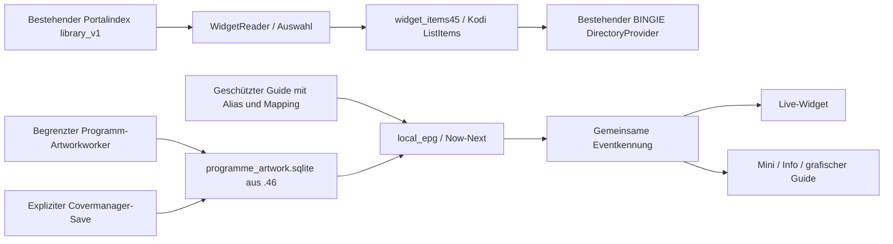

# XCMate .47 – Datenpfade und Ursachenanalyse zu #244 / #245

Basis: veröffentlichte .46, `d9afbc309bd809587013238dfc638cd339c10ee9`, Merge-PR #243. Entwicklung ausschließlich auf `freeze/xcmate-02944-box-b-baseline-20261027`. Keine Geräteverbindung, keine Installation, kein Merge/Release durch Codex. Box A ausgeschlossen.

## Gesicherter Android-Befund und Grenzen der Evidenz

#244: Livegrafiken und Filmwidget FAIL; vollständige horizontale Sendergruppe PASS; Serienwidget PASS. #245 ergänzt den aktuellen .46-Prozess vom27.10.2026:53 Film-Reader-Ereignisse, sämtlich BUDGET/0 (GROUPS18, V2_KEYS15, PAYLOAD19, HEADS1). Live88 Sender publiziert und später88 aus Cache in65ms; Serie24 aus Cache in22ms.48 gemeldete stream_icon-Quellen sind kein Nachweis vorhandener oder sichtbarer Bilder.

GROUPS_READY41623ms und MINI_EPG_VISIBLE48726ms belegen erhebliche reale Latenz. Zwei PLAYER_STOP_DONE, anschließend einmal RETURN_BLOCKED nach Home-Anforderung; kein STOP_TIMEOUT in diesen beiden Abläufen. Der frühere .45-Prozess, externe Repositorywarnungen und die zwei nicht eindeutig zugeordneten SystemExit-Meldungen werden nicht zur bewiesenen .46-Ursache erklärt. Grundlage ist die anonymisierte Issue-Analyse, keine öffentliche Kopie privater Rohlogs.

## Tatsächliche Pfade vor dem Eingriff

## Filmwidget: nachgewiesene Codefehler und gezielte Korrekturen

1. **Payload-Vollscan:** .46 lud24 vollständige Filme über24 OR-Zweige hinter nur `pid/kind`. EXPLAIN zeigt `identity_v2(pid,kind)` statt24 vollständiger Primärschlüsselsuchen. Bei60.000 synthetischen Filmen dauerte dieser Schritt auf dem Host etwa91ms; eine unabhängige Opcode-Grenze reproduziert den Abbruch. .47 verwendet24 vollständige Primärschlüssel-SELECTs in UNION ALL. Kein Schema-/Indexumbau im bestehenden Katalog.
2. **Übermäßige Schlüsselauswahl:** Bei vielen aktivierten Kategorien forderte .46 allein wegen deren Anzahl bis4096 Schlüssel an. .47 beginnt für Filme mit24 und erweitert nur bei tatsächlich beobachteten Dubletten. Der Serienpfad behält seine bisherigen Auswahlregeln und SQL-Abfragen.
3. **Falsch verbrauchtes Gesamtbudget:** Die .46-Uhr begann vor optionalen Imports und Gruppenrichtlinien und lief über mehrere getrennte SQLite-Verbindungen. Somit konnte GROUPS bereits vor seiner eigentlichen SQL-Arbeit auslaufen. .47 verwendet für Filme eine einzige gepinnte mode=ro-Transaktion und strikte Grenzen von150ms je Anweisung/350ms aktiver SQL-Arbeit. Imports und Scheduling werden dadurch nicht als SQL-Laufzeit umetikettiert. Dies ist keine bloße Timeout-Verlängerung; die aufwendigen Scan-/Overscanpfade entfallen.
4. **Kodi-Metadatenvertrag:** Filmzahlen und Laufzeittexte werden über den bereits vorhandenen normalen Film-Normalisierer in gültige InfoTag-Typen überführt. Diese Vertragslücke ist hostseitig geprüft, aber nicht als zusätzliche aus den Androidlogs bewiesene Fehlerursache ausgegeben.
5. **Ableitungscache:** Nur die Film-Widget-Policy bekommt eine neue Revision, damit alte leere .46-Ableitungen nicht unverändert als CACHE weiterleben. Kein globaler Cache-/Artworkreset. Ein echtes leeres/nicht lesbares Filmverzeichnis erzeugt keine generische XCMate-Kachel als vermeintlichen Film.

## Livebilder und tatsächlicher Skin-Consumer

.46 überschreibt thumb/poster/landscape auch ohne passendes Programmbild mit dem neutralen Programmplatzhalter. Das echte Senderlogo existiert danach nur noch als eigene Property. Die geprüfte öffentliche BINGIE-Referenz verwendet native Art-/Skin-Variablen und kennt diese neue Property ohne den separat genehmigten Adapter nicht. Das erklärt einen konkreten Codepfad zu ausschließlich generischen Kacheln; welche Bildquellen auf Box B zusätzlich fehlen oder scheitern, bleibt durch neue Gerätediagnose zu klären.

.47 erhält im nativen Kachelbild ein echtes vorhandenes/kurzzeitig freigegebenes Senderlogo, solange kein verifiziertes Programmbild existiert. Das neutrale Programmbild und das separate Logo bleiben zusätzlich in ihren eigenen Properties für den grafischen Guide/Renderer. Ein echtes Programmbild gewinnt. Ohne Logo bleibt der echte Sendername; kein erfundenes Bild. Die88 Android-bestätigten Sender, alle weiteren aktivierten Gruppen und genaue Klickziele bleiben erhalten.

Ein kleines **oben links** über einem Programmbild liegendes Logo erfordert weiterhin einen tatsächlichen Skin-Consumer. Properties allein beweisen keine Darstellung. Fehlende Bindings beziehungsweise Reload-Hooks bleiben `BLOCKED_NO_OVERLAY_FOCUS_BINDING` / `BLOCKED_NO_RELOAD_HOOK`. Keine Skin-Datei und keine Widgetzuweisung wird automatisch geändert. Die vorhandene separat bestätigungspflichtige Adapterfunktion bleibt unverändert.

## Gemeinsamer lokaler Bestand

Die vorhandene `programme_artwork.sqlite` bleibt die einzige neue Programm-/Artworkschicht. Keine dritte konkurrierende EPG-Datenbank. Additive Tabellen `channels47`, `asset_refs47`, `widget_diagnostics47` enthalten Kanalreferenzen, geprüfte Bildreferenzen und sichere Zählwerte. Vorhandene Application-ID/Schema1 bleiben erhalten; unbekannte oder kollidierende Schemata werden unverändert blockiert. Die Initialisierung ist per Savepoint atomar.

Der Guide mit manuellen Zuordnungen ist weiterhin führend. Der gemeinsame Cache ergänzt echte zuvor veröffentlichte Fakten, nie erfundene Ereignisse. Bei fehlender primärer Datei sind bereits verifizierte gemeinsame Fakten read-only als LastGood nutzbar; dabei wird keine Guide-Datei angelegt.7 volle vergangene und bis20 zukünftige Tage bleiben an tatsächlich vorhandene Daten und die bestehenden Quell-/Kalenderregeln gebunden. Keine Retention-/Bildlöschung.

Guide, Mini, Infoleiste und Live-Widget verwenden dieselbe Eventkennung. Der RAM-Now/Next-Wechsel bewahrt kanonischen Kanal und Quellmetadaten. Text bleibt offline unabhängig vom Bild. Eventbilder bleiben im begrenzten .46-Worker mit TTL/negativen Treffern, Quellenprovenienz und strengem Episodenabgleich.

**Dynamische Cover bleiben dynamisch.** Die neue Assettabelle persistiert hierfür nur freigegebene Referenzen mit unverändert maximal30s DNS-Gültigkeit und bestehenden Kodi-Redirectgrenzen. Kein zusätzliches permanentes Provider-Coverarchiv, keine Änderung des Artworkmodus. Der Hintergrundpfad berücksichtigt auch Sender jenseits der bisherigen ersten24. GUI-Lesen erzeugt weder DNS noch Bildabrufe.

Der Covermanager spiegelt eine ausdrücklich gespeicherte, bereits verifizierte Auswahl als SHA-geprüfte PNG-/JPEG-Anzeigereferenz in die gemeinsame Schicht. Das ursprüngliche manuelle Bild und sein Manifest bleiben erhalten und maßgeblich. Eine Budget-/DB-Störung der optionalen Referenz macht die ursprüngliche Auswahl nicht ungültig. Keine automatische Massenmigration alter Bilder.

## Start-/Gruppenlatenz und Arbeitsisolation

Seitenweise, threadlokale read-only SQLite-Sitzungen ersetzen wiederholte Verbindungen pro Ereignis. Verbindungen werden niemals zwischen Threads geteilt und am Seitenende auch bei Fehlern geschlossen. Quellrichtlinien werden nur innerhalb derselben Seite wiederverwendet.

Der Live-Katalogfastpfad liest die vorhandenen lokalen Gruppennamen, bevor irgendeine Provider-Kategorie-JSON-Datei deserialisiert wird. Senderobjekte und CatalogIndex werden im vorhandenen Hintergrundworker erstellt; der GUI-Owner übernimmt ein fertiges Modell. Die Startgruppe wird vor dem Rest angeboten. Ein fehlerhafter Live-/Film-Artworkschritt darf die24 erfolgreichen Serien nicht mehr am Publizieren hindern.

Neue PREPARE47-Marker trennen lokalen Lesebeginn, vorbereitetes Startgruppenmodell und vollständiges Modell. FLOW46/LIVE_TIMING bleiben für Klick/Playback/Video/Mini/Gruppen erhalten. Dies sind Add-on-/Playerzustandsmessungen, keine Messung eines physischen IR-Signals oder tatsächlich decodierten Displayframes. Hostzahlen erklären keine exakt bestimmte Android-Millisekundenlücke; echte Cold/Warm-p50/p95 bleiben offen.

## Live-Rückkehr und Player-State-Race

Native .42-Kompatibilitätsstrategie, native Stop-Queue und Exit-Jobs bleiben bytegleich. Unmittelbar vor einer Home-Entscheidung wird die aktuelle Session-/Phasen-Latch erneut geprüft: Eine bereits von einem anderen Poll festgeschriebene Home-Anforderung darf nicht nachträglich als RETURN_BLOCKED überschrieben werden. Fremde Modaldialoge werden weder geschlossen noch ignoriert.

Nach nachweislich abgeschlossener eigener nativer Stop-Arbeit gilt ein kurzzeitig noch gesetztes Playing-Flag bei verschwundenem InfoTag als unbekannter Zustand; kein zweiter Stop und keine voreilige Fremdplayer-Zuweisung. Ein belegter Fremdplayer bleibt geschützt. Die .46-Late-ACK-Erholung bleibt erhalten. Ein dauerhaft blockierter nativer Kodi-/Rockchip-Stop ohne Rückkehr ist weiterhin kein in Python behobener Decoderfehler.

## Diagnose und verbleibende Abnahme

WIDGET47 protokolliert pseudonymisierte Korrelation, feste Stufen und Zählwerte: Sync-Received/Stored, im Budget ermittelbare Indexanzahl, ausgewählte Titel, tatsächliche ListItems, lokales/dynamisches Bild beziehungsweise Platzhalter und erfolgreich abgeschlossenes Kodi-Verzeichnis. Importzähler sind ausdrücklich keine Zahl eindeutiger Providerfilme. Unbekannte Zahlen werden als−1 ausgewiesen; kein synchroner Providerabruf zur Zählung.

Die Statusansicht unterscheidet leere neue DB, lokale Texte ohne passende Bilder, Bildreferenzen und fehlenden Bilddecoder. Kodi-/EGL-Texturedecode und tatsächlich sichtbare Pixel sind über ListItem nicht belegbar und bleiben Geräteabnahme. Alle neuen .47-Androidfälle NOT_TESTED. Historische .46-FAIL/PASS bleiben im Testplan getrennt erhalten.
